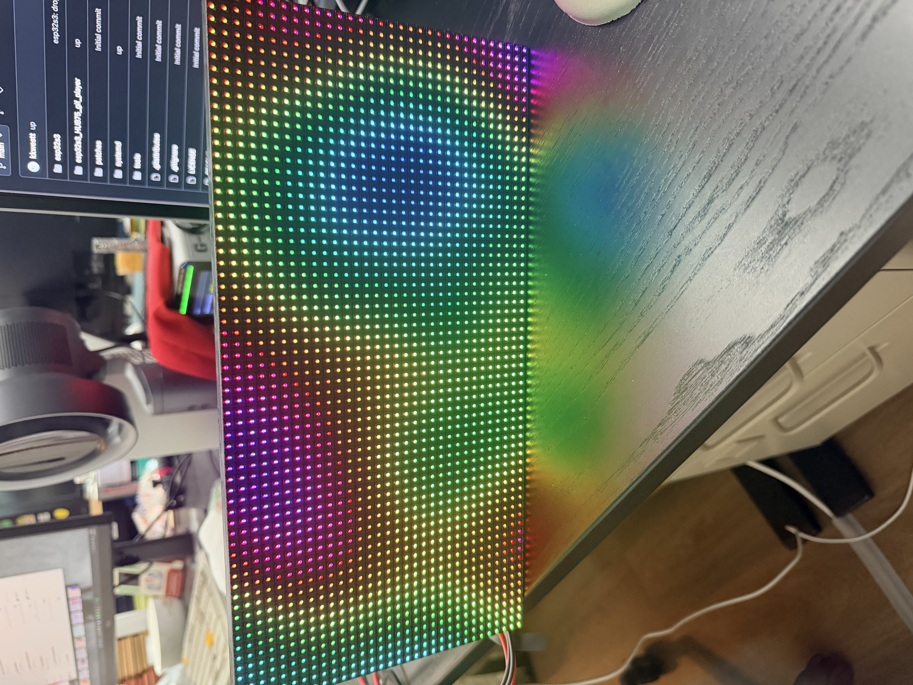
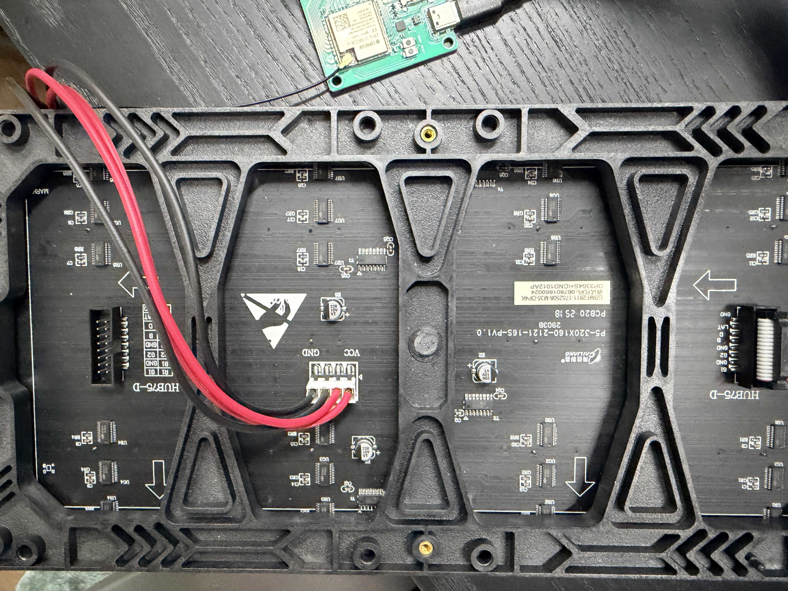

# DP3364S (S-PWM) ต่างจากแผง HUB75 ทั่วไปยังไง

- **แผงทั่วไป**: ชิปบนแผงเป็นแค่ shift register + ตัวจ่ายกระแส **ไม่มีหน่วยความจำ ไม่ทำ PWM เอง**
  ไมโครคอนโทรลเลอร์ต้องยิงข้อมูลซ้ำ ๆ ตลอดเวลาและกะพริบ OE เองเพื่อให้เกิดความสว่างแต่ละระดับ
- **DP3364S (S-PWM)**: ชิปมี **SRAM เก็บค่าสีไว้เอง และสร้าง PWM เองจากนาฬิกา CLK**
  ไมโครคอนโทรลเลอร์ส่งภาพทีละเฟรม แล้วชิปแสดงผลต่อเองด้วย refresh สูงมาก

## ตารางเทียบ

| หัวข้อ | HUB75 ทั่วไป (ICN2037, FM6124, MBI5124 …) | DP3364S (S-PWM) |
|---|---|---|
| หน่วยความจำในชิป | ไม่มี — แค่ latch 16 บิต (เปิด/ปิด) | มี SRAM เก็บค่าสี 16 บิตต่อช่อง (เฟรมคู่) |
| ใครทำ PWM | MCU ทำ (Binary Code Modulation) ส่ง bit-plane ซ้ำหลายรอบ | ชิปทำเอง แบบ Scrambled PWM กระจายช่วงเปิดทั่วเฟรม |
| ข้อมูลต่อพิกเซล | 1 บิตต่อสีต่อรอบ ต้องส่งซ้ำ depth รอบ | 16 บิตต่อสี ส่งครั้งเดียวต่อเฟรม |
| ระดับสี | ขึ้นกับแบนด์วิดท์ MCU (มัก 6–8 บิต) | สูงสุด 14 บิต (ที่ใช้อยู่ 12 บิต: REG03 = REG04 = 0x3F → 64×64 ระดับ) |
| Refresh | ~60–110 Hz ที่ 64x64 depth 8 (จาก log ไลบรารีเดิม) | ~3.8 kHz (datasheet 3840/7680 Hz) |
| ขา OE | เปิด/ปิด LED + คุมความสว่าง | กลายเป็น **ROW** — พัลส์บอกชิปให้ขึ้นแถวถัดไป |
| ขา CLK | หยุดได้ระหว่างแถว | **ห้ามหยุด** — ชิปเอา CLK เข้า PLL ทำเป็น GCLK (GCLK = DCLK × (REG06[2:0]+1)) |
| ขา LAT | latch ข้อมูล 1 ครั้ง | เป็น **คำสั่ง** — นับจำนวน CLK ระหว่าง LAT ค้าง HIGH |
| ตั้งค่าก่อนใช้ | ส่วนใหญ่ไม่ต้อง (FM6126A มี init สั้น ๆ) | ต้องเขียนรีจิสเตอร์ 13 ตัว (จำนวนแถว, PWM, PLL, กระแส …) |
| ความสว่าง | ปรับด้วยความกว้าง OE | ไม่มี OE ให้หรี่ → ปรับผ่านตารางแกมมา หรือรีจิสเตอร์กระแส REG08 |
| ถ่ายวิดีโอ | เห็นเส้นกะพริบชัด | แทบไม่เห็น (refresh สูง) |
| ภาระ MCU | หนัก ต้องป้อนข้อมูลตลอด | เบา — ส่งเฟรมแล้วจบ แต่ CLK ต้องวิ่งต่อเนื่อง |

## คำสั่งผ่านขา LAT (จำนวน CLK ที่ LAT ค้าง HIGH)

| คำสั่ง | CLK | ทำอะไร |
|---|---|---|
| DATA_LATCH | 1 | เก็บ 16 บิตลง SRAM |
| VSYNC | 3 | สลับไปแสดงเฟรมใหม่ |
| WR_CFG | 5 | เขียนรีจิสเตอร์ |
| PRE_ACT | 14 | ปลดล็อกการเขียนรีจิสเตอร์ |
| SDR | 15 | โหมด single-edge — **อย่าส่ง** แผงแบบนี้จอดับ |

## ทำไมไลบรารีปกติขับแล้วจอดับ

ไลบรารี HUB75 ทั่วไป (ESP32-HUB75-MatrixPanel-DMA, Protomatter, hzeller ตัวปกติ):

1. ไม่เคยเขียนรีจิสเตอร์ → ชิปไม่รู้จำนวนแถว / ค่า PWM
2. ไม่ส่ง VSYNC → ชิปไม่สลับเฟรมขึ้นแสดง
3. ใช้ OE เป็นตัวหรี่แสง → แต่สำหรับ DP3364S มันคือสัญญาณ ROW
4. ส่ง bit-plane 1 บิต → ชิปรอข้อมูล 16 บิตต่อช่อง

ผลคือ "จอดับสนิท" ไม่ใช่ภาพเพี้ยน

## เราขับยังไง (LEDArt / ไลบรารี DP3364S)

- สร้าง **บิตสตรีมทั้งก้อน** ไว้ใน RAM: 1 คำ (16 บิต) = สถานะทุกขาใน 1 CLK
  (R1 G1 B1 R2 G2 B2, A–E, LAT, ROW)
- **LCD_CAM + GDMA** ของ ESP32-S3 ส่งวนไม่รู้จบ: `[รีจิสเตอร์ 13 ตัว] → [เฟรม] × 16 → วนใหม่`
  CLK สร้างจากฮาร์ดแวร์ จึงนิ่งเสมอ ไม่ขึ้นกับ WiFi หรือ CPU
- ในเฟรม: VSYNC → พัลส์ ROW กว้าง 4 CLK ทุก 128 CLK พร้อมนับแถว A–D →
  ระหว่างนั้นเลื่อนข้อมูล 16 บิต × จำนวนชิป แล้วปิดด้วย DATA_LATCH
- CPU แค่ **เขียนบิตสีทับในเฟรมเดิม** ทุกครั้งที่ภาพเปลี่ยน ไม่ต้องหยุดสตรีม
- เขียนรีจิสเตอร์ซ้ำ ~20 ครั้ง/วินาที → ไฟตก/สายหลุดแล้วกลับมาติดเอง
- เก็บสตรีมใน **RAM ภายใน** (64x32 ใช้ ~51 KB) ไม่ใช้ PSRAM เพราะตอนเขียนแฟลช
  DMA จาก PSRAM จะสะดุด → CLK สะดุด → จอกะพริบ

## ค่ารีจิสเตอร์ที่ใช้ (ดักมาจากการ์ดจริง ของแผง 128x64)

```
0x1100 0x02xx 0x033F 0x043F 0x0504 0x0642 0x0700
0x08BF 0x0960 0x0ABE 0x0B8B 0x0C08 0x0D12
```

- `0x02xx` = จำนวนแถวสแกน − 1 → แผงนี้ (1/16) = `0x020F`
- `0x08BF` = เกนกระแส, `0x0642` = ตัวคูณ PLL, `0x033F`/`0x043F` = จำนวนกลุ่ม / ความยาว PWM
- datasheet ฉบับเผยแพร่ไม่มีตารางครบ ค่าที่เหลือมาจากการดักสัญญาณ

## ข้อสังเกตจากการใช้งานจริง
- ไม่ต้องใช้สาย E (แผง 1/16 ใช้แค่ A–D)

## ทดสอบกับอะไรไป (2026-11-17)

### แผง LED — ดูรูป `docs/IMG_6666.JPG`

| รายการ | ค่า |
|---|---|
| รุ่น (silkscreen) | `P5-320X160-2121-16S-PV1.0` · `2903B` · `PCB20 2518` |
| ผู้ผลิต | 海佳彩亮 (Cailiang) |
| ขนาด | 320×160 มม. → 64×32 พิกเซล, pitch 5 มม., หลอด SMD 2121 |
| Scan | 1/16 (`16S`) |
| ชิป (ตามสติกเกอร์) | **DP3364S** (คอลัมน์) + **ICND1012AP** (แถว) |
| สติกเกอร์ | `GBMF2811-1752508-M35-DP4K` · 调试代码 `067801860024` |
| ขั้วต่อ | HUB75-D 2 ช่อง (เข้า / ออก) + ขั้วไฟ VCC/GND 4 ขา |

### บอร์ดควบคุมและการต่อสาย — ดูรูป `docs/IMG_6668.JPG`

| รายการ | ค่า |
|---|---|
| บอร์ด | PX-Board-x3 (PCB สีเขียว) |
| MCU | ESP32-S3-WROOM-1U-N16R8 (เสาภายนอก u.FL) |
| บัฟเฟอร์ | 74HC245 ×2 แปลง 3.3 V → 5 V |
| สายข้อมูล | สายแพ HUB75 16 ขา เข้าช่อง HUB75-D **ฝั่งที่ลูกศร ⇨ ชี้ออก** (ช่องซ้ายเมื่อมองจากด้านหลังในรูป) |
| ไฟแผง | 5 V แยกจากบอร์ด สายแดง/ดำเข้าขั้ว VCC/GND กลางแผง |
| ขาที่ใช้ | R1=45 G1=39 B1=48 R2=47 G2=40 B2=21 · A=14 B=41 C=13 D=42 · LAT=38 OE(ROW)=2 CLK=1 · E ไม่ใช้ |

### ซอฟต์แวร์และค่าที่ใช้

| รายการ | ค่า |
|---|---|
| เฟิร์มแวร์ | LEDArt-Display (PlatformIO, Arduino core 2.0.17) เลือกไดรเวอร์ `dp3364s` ในหน้าตั้งค่าจอ |
| ขนาด | 64×32 × 1 แผง |
| CLK | 8 MHz, เฟสปกติ (log บอร์ดยืนยัน `phase 0`) |
| สตรีม | 52,328 ไบต์ ใน RAM ภายใน |
| ภาพที่แสดง | ลายพลาสม่า `plasma_64x32.gif` อัปโหลดผ่านหน้าเว็บ |

### ผลทดสอบ

- **สัญญาณฝั่ง ESP32 ถูกต้อง** — สุ่มอ่านระดับ GPIO ขณะสตรีมวิ่ง: CLK duty 50%, ROW ค้าง HIGH 3.07%
  (ออกแบบไว้ 4/128 = 3.1%), A/B/C/D นับแถวแบบเลขฐานสอง, E เป็น 0 ตลอด, ข้อมูลสีออกตรงพิกเซลที่วาด
- **ตอนแรกจอดับ** ทั้งที่สัญญาณฝั่ง ESP32 ครบ — ติดหลังแก้ฝั่งฮาร์ดแวร์ (สาย/ไฟ)
  ค่าในเฟิร์มแวร์ไม่ได้เปลี่ยน เฟส Clock ยังเป็นค่าปกติ
- **แผงติด แสดงภาพเคลื่อนไหวได้** — `docs/IMG_6665.mov` (15:00) และ `docs/IMG_6667.JPG` (15:20)
- สเก็ตช์ Arduino `DP3364S_PanelTest` (โฟลเดอร์นี้) คอมไพล์ผ่านกับ ESP32 core 3.3.11 —
  ใช้โค้ดสร้างบิตสตรีมชุดเดียวกับเฟิร์มแวร์ แต่ยังไม่ได้ยืนยันบนแผงจริง




## อ้างอิง

- DP3364S datasheet EN: <https://github.com/user-attachments/files/25687538/DP3364S.pdf>
- kkwestt/RaspberryPi-HUB75-DP3364S-Matrix (ต้นแบบบิตสตรีม, MIT) https://github.com/kkwestt/RaspberryPi-HUB75-DP3364S-Matrix
- hzeller/rpi-rgb-led-matrix issue #1866, #1821
