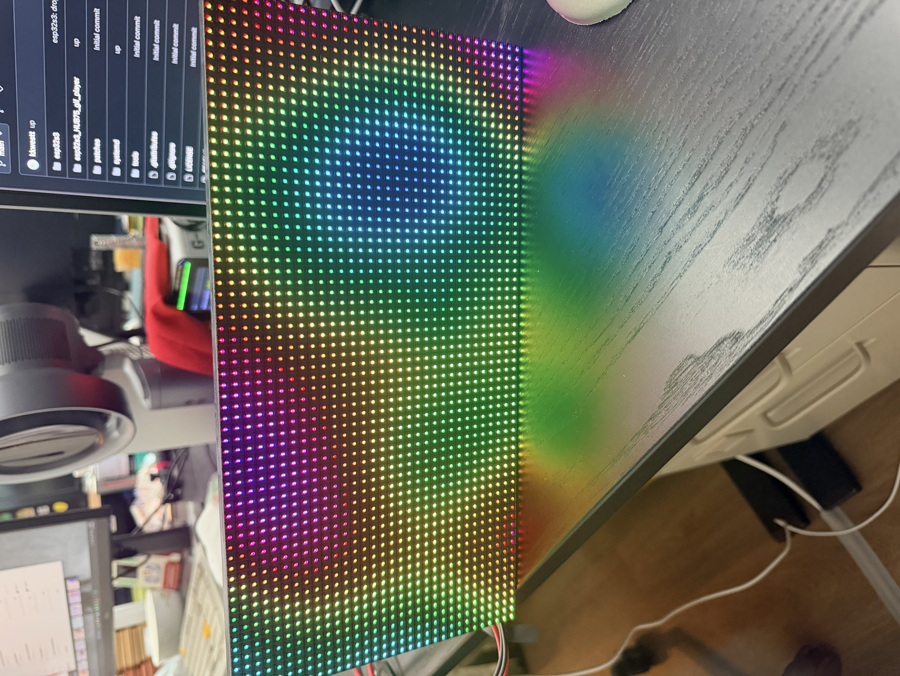
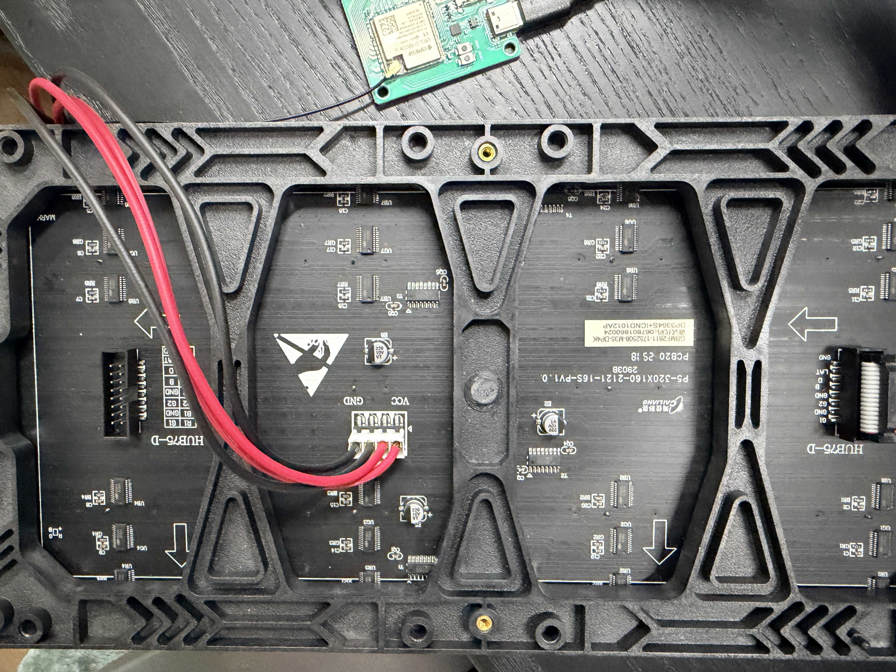

# DP3364S_ESP32

Arduino driver for **DP3364S S-PWM HUB75 LED panels** on the **ESP32-S3**, with a
ready-to-flash panel test sketch.



Ordinary HUB75 libraries (ESP32-HUB75-MatrixPanel-DMA, Protomatter, the stock
rpi-rgb-led-matrix) leave these panels completely dark. This library drives them by
streaming the exact bitstream the DP3364S expects through the ESP32-S3's LCD_CAM
peripheral and GDMA, with a clock that never stops.

## Why DP3364S panels need their own driver

| | Standard HUB75 (ICN2037, FM6124, MBI5124 …) | DP3364S (S-PWM) |
|---|---|---|
| Memory in the chip | None, just a 16-bit on/off latch | SRAM holding 16-bit grey per channel (double-buffered) |
| Who does the PWM | The MCU, resending bit-planes (BCM) | The chip, scrambled PWM spread across the frame |
| Data per pixel | 1 bit per colour, repeated for every bit-plane | 16 bits per colour, sent once per frame |
| Refresh | ~60–110 Hz at 64x64, 8-bit depth | ~3.8 kHz (datasheet 3840 / 7680 Hz) |
| OE pin | Enables the LEDs, sets brightness | Becomes **ROW**: a pulse that advances to the next scan line |
| CLK pin | May stop between rows | **Must never stop**: it feeds the PLL that makes the grey clock |
| LAT pin | Latches data once | Carries **commands**, chosen by how many CLKs it stays high |
| Setup | Usually none | 13 configuration registers must be written |

Commands are selected by the number of CLK cycles LAT stays high:

| Command | CLKs | Effect |
|---|---|---|
| DATA_LATCH | 1 | Store 16 bits into SRAM |
| VSYNC | 3 | Show the newly loaded frame |
| WR_CFG | 5 | Write a configuration register |
| PRE_ACT | 14 | Unlock register writes |
| SDR | 15 | Single-edge mode. **Never sent**: it blanks these panels |

A standard library never writes the registers, never sends VSYNC, and uses OE as a
dimmer, so the chip shows nothing at all.

## Features

- Hardware-timed output: GDMA loops `[13 registers] → [frame] × 16` into LCD_CAM
  (i8080, 16-bit bus) forever, so CLK is perfectly steady regardless of Wi-Fi or
  CPU load.
- Extends **Adafruit_GFX**: text, lines, shapes, bitmaps and `setRotation()` work
  out of the box.
- 12-bit grey scale with a CIE 1931 gamma table; brightness is applied through the
  table (there is no OE to dim with).
- Registers are rewritten about 20 times a second, so a panel recovers by itself
  after a power or cable glitch.
- If LCD_CAM stops on its own after a cold power-up, `show()` restarts it.
- The bitstream lives in internal RAM, not PSRAM: flash writes stall PSRAM DMA,
  which would stall CLK and make the panel flicker.

## Tested hardware

| Part | Details |
|---|---|
| Panel | `P5-320X160-2121-16S-PV1.0` by Cailiang (海佳彩亮): 64x32 px, 5 mm pitch, SMD 2121, 1/16 scan |
| Panel chips | DP3364S column drivers + ICND1012AP row driver (sticker `GBMF2811-1752508-M35-DP4K`) |
| Controller | PX-Board-x3: ESP32-S3-WROOM-1U-N16R8, 2 × 74HC245 level shifters (3.3 V → 5 V) |
| Clock | 8 MHz, normal phase |
| Panel power | Separate 5 V supply into the panel's VCC/GND terminal |



The panel was verified with this exact bitstream inside the LEDArt-Display
firmware (PlatformIO, Arduino-ESP32 core 2.0.17). The sketch in this repository
builds cleanly on Arduino-ESP32 core 3.3.11. See [`docs/`](docs) for photos and a
video of the panel running.

## Repository layout

```
DP3364S_PanelTest/        test sketch: open in the Arduino IDE and upload
libraries/
  DP3364S/                the driver library (MIT)
  Adafruit_GFX_Library/   1.12.6, bundled dependency
  Adafruit_BusIO/         1.17.4, required by Adafruit GFX
docs/                     test photos and video
DP3364S-vs-HUB75-ทั่วไป.md  detailed notes in Thai
```

## Installation

1. Copy every folder in `libraries/` into your Arduino libraries folder
   (`Documents/Arduino/libraries/` on macOS and Windows). Skip Adafruit GFX and
   BusIO if you already have them.
2. Install the **esp32 by Espressif** board package (core 3.x; the library also
   contains code paths for core 2.x).
3. Restart the Arduino IDE and open `DP3364S_PanelTest/DP3364S_PanelTest.ino`.

### Board settings (Tools menu)

| Setting | Value |
|---|---|
| Board | ESP32S3 Dev Module |
| USB CDC On Boot | Disabled (the PX-Board's USB-C goes through a CH343 USB-UART) |
| Flash Size | 16MB |
| PSRAM | OPI PSRAM (optional; the driver uses internal RAM) |
| Serial Monitor | 115200 baud |

## Wiring (PX-Board-x3 defaults)

| Signal | GPIO | Signal | GPIO |
|---|---|---|---|
| R1 | 45 | A | 14 |
| G1 | 39 | B | 41 |
| B1 | 48 | C | 13 |
| R2 | 47 | D | 42 |
| G2 | 40 | E | not used on 1/16 scan (`-1`) |
| B2 | 21 | LAT | 38 |
| CLK | 1 | OE → ROW | 2 |

Change the `PINS` constant in the sketch for other boards. The order is
`R1 G1 B1 R2 G2 B2, A B C D E, LAT OE CLK`.

## Quick start

```cpp
#include <DP3364S.h>

const DP3364S_Pins PINS = {45, 39, 48, 47, 40, 21, 14, 41, 13, 42, -1, 38, 2, 1};
DP3364S panel(64, 32); // 64 per chained panel; height 16, 32 or 64

void setup() {
  if (!panel.begin(PINS)) {        // or begin(PINS, 8000000, false)
    Serial.println(panel.error());
  }
  panel.setBrightness(128);        // 0..255
}

void loop() {
  panel.fillScreen(0);
  panel.setTextColor(DP3364S::color565(255, 200, 0));
  panel.setCursor(2, 12);
  panel.print("Hello");
  panel.drawPixelRGB888(63, 31, 0, 255, 255);
  panel.show();                    // push the drawing to the panel
  delay(33);
}
```

### API

| Method | Purpose |
|---|---|
| `begin(pins, clockHz = 8000000, clockInvert = false)` | Allocate the stream and start output; `false` on failure |
| `show()` | Encode the drawing into the stream; call after every frame |
| `clear()` | Fill black and show |
| `setBrightness(level)` | 0..255, applied on the next `show()` |
| `drawPixelRGB888(x, y, r, g, b)` | Draw with full 8-bit colour |
| `color565(r, g, b)` | Pack a colour for the Adafruit GFX methods |
| `error()` | Reason for a failed `begin()` |
| `restarts()` | How many times the output had to be restarted |

Every Adafruit_GFX method (`drawLine`, `fillRect`, `print`, `drawBitmap`,
`setRotation`, …) is available as well.

## Test sketch

The sketch cycles through these screens every 4 seconds. Press **BOOT (IO0)** to
skip to the next one. Each name is printed to the serial monitor.

red → green → blue → white → colour bars → R/G/B/W gradients → grid →
corners (red top-left, green top-right, blue bottom-left, white bottom-right) →
row scan → column scan → plasma → scrolling text

Settings at the top of the sketch:

| Define | Default | Notes |
|---|---|---|
| `PANEL_WIDTH` | 64 | 64 × number of chained panels |
| `PANEL_HEIGHT` | 32 | 16, 32 or 64 |
| `CLOCK_HZ` | 8000000 | 8 MHz is known to work |
| `CLOCK_INVERT` | false | Try `true` if the image is garbled |
| `BRIGHTNESS` | 128 | Full white at 255 draws about 4 A per panel |

## Memory

The stream must fit in one contiguous block of internal DMA-capable RAM:

| Layout | Stream size |
|---|---|
| 64x32 (1 panel) | 52 KB |
| 128x32 (2 panels) | 87 KB |
| 64x64 | 86 KB |
| 256x32 (4 panels) | 156 KB |

## How the bitstream works

Each 16-bit word is the state of every HUB75 line for one CLK period:
`R1 G1 B1 R2 G2 B2` on D0–D5, `A–E` on D6–D10, `LAT` on D11 and `ROW` (the OE
pin) on D12.

- **Frame:** VSYNC, then a ROW pulse 4 clocks wide every 128 clocks while A–D count
  the scan lines. Meanwhile the pixel data shifts in, 16 bits per chip MSB first,
  and each block ends with a one-clock DATA_LATCH.
- **Registers:** `0x1100 0x02xx 0x033F 0x043F 0x0504 0x0642 0x0700 0x08BF 0x0960
  0x0ABE 0x0B8B 0x0C08 0x0D12`. `REG02` is set to scan lines − 1 (`0x020F` for
  1/16 scan). The rest were captured from a working receiving card.
- **Updates:** `show()` rewrites only the colour bits of the frame in place; the
  stream never pauses.

## Troubleshooting

| Symptom | Check |
|---|---|
| Panel completely dark | Cable in the panel's **input** HUB75 connector (the arrows point away from it); separate 5 V supply connected, with GND shared with the board; serial monitor shows `DP3364S 64x32 running` |
| `init failed` on the serial monitor | Read the message: usually not enough internal RAM for the panel size |
| Garbled image | Set `CLOCK_INVERT` to `true` |
| Red and blue swapped | Swap `r1`/`b1` and `r2`/`b2` in `PINS` |
| Washed-out colour | Adjust the registers in `DP3364S_Stream.cpp` one at a time, starting with `REG02` |

## Credits and license

- `libraries/DP3364S` is MIT licensed. The bitstream layout and the LCD_CAM output
  are ported from
  [kkwestt/RaspberryPi-HUB75-DP3364S-Matrix](https://github.com/kkwestt/RaspberryPi-HUB75-DP3364S-Matrix)
  (MIT); see [`libraries/DP3364S/LICENSE`](libraries/DP3364S/LICENSE).
- Adafruit GFX and Adafruit BusIO keep their own licenses in their folders.
- DP3364S datasheet (EN):
  <https://github.com/user-attachments/files/25687538/DP3364S.pdf>
- Background: hzeller/rpi-rgb-led-matrix issues
  [#1866](https://github.com/hzeller/rpi-rgb-led-matrix/issues/1866) and
  [#1821](https://github.com/hzeller/rpi-rgb-led-matrix/issues/1821).
